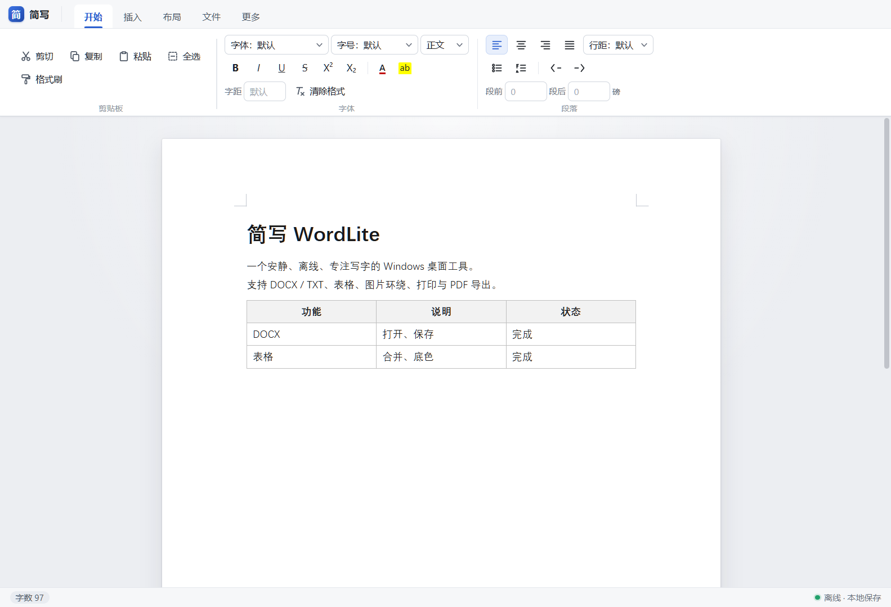

<p align="center">
  
</p>

<h1 align="center">WordLite 简写</h1>

<p align="center">
  <b>An offline, lightweight desktop word processor that feels like Word</b><br>
  Open it and write. No network, no account, no data collection.
</p>

<p align="center">
  
  
  
  
</p>

<p align="center">
  <a href="README.md">简体中文</a> · <b>English</b>
</p>

<p align="center">
  
</p>

> The user interface is currently in Simplified Chinese only.

## Why

Writing a notice, an article or a checklist with a table rarely needs a full office suite or AI tools — and you may not want your files in the cloud.
WordLite does one thing: **format text on your own machine, save it as DOCX, or print / export it to PDF.**

- 🔒 **Fully offline** — the app makes no network requests; files are read and written through native dialogs
- 📄 **DOCX compatible** — opens Word / WPS documents and saves files they can open
- 🪶 **Lightweight** — Tauri 2 + the system WebView2 runtime; installer is about 2.6 MB
- 🪟 **Multi-window** — dropping a file or using "Open with" opens a separate window for side-by-side comparison; in-app opens stay in the current window
- 💾 **Never lose a draft** — periodic autosave with crash recovery

## Download

1. Grab `WordLite_<version>_x64-setup.exe` from [Releases](../../releases/latest)
2. Run the installer
3. Launch from the Start menu or desktop

> Builds are not code-signed yet. If SmartScreen shows "Windows protected your PC", click **More info → Run anyway**.
> Requires the Microsoft Edge WebView2 runtime; Windows 11 and most Windows 10 installations already have it.

## Features

| Area | What you can do |
| --- | --- |
| Files | Open / save DOCX and TXT (auto-detects UTF-8, UTF-16, GBK), open via double-click / "Open with" / drag-and-drop, recent files, autosave and crash recovery |
| Editing | Find / replace, case-sensitive search, highlight all matches and jump between them |
| Windows | In-app opens stay in the current window (Save / Don't save / Cancel when modified); drops and "Open with" open a separate window |
| Text | Font, size, color, highlight, bold, italic, underline, strikethrough, super/subscript, letter spacing, format painter |
| Paragraphs | Headings 1–3, alignment, indent, line height, spacing before/after, bulleted and numbered lists |
| Tables | Insert, drag column widths, merge / split cells, cell shading, border width and color |
| Images | Insert, precise resize, left / center / right align, text wrapping, crop, replace, delete |
| Page | Paper size, orientation, custom margins, page background, page breaks |
| Output | Print (page range and copies via the system print dialog), print preview, export to PDF |

<details>
<summary><b>Keyboard shortcuts</b> (also available in the app with <kbd>F1</kbd>)</summary>

| Action | Shortcut |
| --- | --- |
| New / Open / Save / Save as | <kbd>Ctrl+N</kbd> / <kbd>Ctrl+O</kbd> / <kbd>Ctrl+S</kbd> / <kbd>Ctrl+Shift+S</kbd> |
| Print preview | <kbd>Ctrl+P</kbd> |
| Find / Replace | <kbd>Ctrl+F</kbd> / <kbd>Ctrl+H</kbd> |
| Bold / Italic / Underline | <kbd>Ctrl+B</kbd> / <kbd>Ctrl+I</kbd> / <kbd>Ctrl+U</kbd> |
| Strikethrough | <kbd>Ctrl+Shift+X</kbd> |
| Superscript / Subscript | <kbd>Ctrl+Shift+=</kbd> / <kbd>Ctrl+=</kbd> |
| Increase / Decrease font size | <kbd>Ctrl+Shift+&gt;</kbd> / <kbd>Ctrl+Shift+&lt;</kbd> |
| Format painter: copy / apply | <kbd>Ctrl+Shift+C</kbd> / <kbd>Ctrl+Shift+V</kbd> |
| Heading 1 / 2 / 3 / Body | <kbd>Ctrl+1</kbd> / <kbd>Ctrl+2</kbd> / <kbd>Ctrl+3</kbd> / <kbd>Ctrl+0</kbd> |
| Align left / center / right / justify | <kbd>Ctrl+L</kbd> / <kbd>Ctrl+E</kbd> / <kbd>Ctrl+R</kbd> / <kbd>Ctrl+J</kbd> |
| Bullet / Numbered list | <kbd>Ctrl+Shift+8</kbd> / <kbd>Ctrl+Shift+7</kbd> |
| Increase / Decrease indent | <kbd>Ctrl+M</kbd> / <kbd>Ctrl+Shift+M</kbd> |
| Insert page break | <kbd>Ctrl+Enter</kbd> |

</details>

## Run from source

Requires:

- [Node.js](https://nodejs.org/) 22+
- [Rust](https://rustup.rs/) stable
- Visual Studio Build Tools (C++ workload) and the Windows SDK
- Microsoft Edge WebView2 runtime

```bash
git clone <this-repo-url>
cd WordLite
npm install
npm run tauri:dev     # build the renderer and launch the Tauri window
```

Build the installer:

```bash
npm run tauri:build   # output in src-tauri/target/release/bundle/nsis/
npm run build         # rebuild renderer/bundle.js only
```

Self-test:

```bash
src-tauri/target/release/wordlite.exe --selftest
```

> The first bundle run downloads NSIS from GitHub.

<details>
<summary><b>Project structure</b></summary>

```text
src-tauri/              Tauri 2 / Rust main process
  src/lib.rs            windows, files, autosave, print / PDF
  tauri.conf.json       window, CSP, bundle configuration
  capabilities/         permissions (main and doc-* windows)
renderer/
  index.html            UI structure
  style.css             UI and print styles
  app.js                editor, ribbon, files, print, settings
  docx.js               DOCX import / export
  extensions.js         custom TipTap extensions (tables, images, paragraph formatting, etc.)
  tauri-bridge.js       window.wordlite compatibility layer for Tauri
tools/
  make-icon.py          icon generation script (Python + Pillow)
assets/                 app icons
docs/                   README screenshot and migration notes
```

`renderer/bundle.js` is a build artifact and is not committed.

</details>

## Privacy & security

- Tauri 2 + Rust backend; the frontend can only call whitelisted commands
- Files are read and written through native system dialogs
- CSP is restricted to `default-src 'self'`; the app makes no network requests
- No analytics, no telemetry, no auto-update

## Known limitations

- Only Windows 10 / 11 is packaged and tested; macOS support is in progress (WKWebView print / PDF not finished yet)
- Print preview paginates by content blocks; a single extremely long paragraph without breaks is not split by line in the preview (the PDF / print engine still paginates by line)
- Text boxes, nested tables and complex fields are simplified on DOCX import
- Image text wrapping supports left and right only
- No code signing yet

## FAQ

**SmartScreen says "Windows protected your PC"?**
The build is not signed yet. Click **More info → Run anyway**, then launch from the Start menu.

**WebView2 is missing?**
Install the Microsoft Edge [WebView2](https://developer.microsoft.com/zh-cn/microsoft-edge/webview2) Runtime (Windows 11 and most Windows 10 installations already have it).

**Where are files stored?**
Wherever you save them. Autosave recovery copies live in `%APPDATA%\com.h1kayemizbitti.wordlite\autosave-*.json` and are cleared after a successful save or choosing "Don't save".

## Contributing

Issues and pull requests are welcome. Please run the build and self-test before submitting:

```bash
npm run tauri:build
src-tauri/target/release/wordlite.exe --selftest
```

For bug reports, attaching a (sanitized) sample document that reproduces the problem helps a lot.

## Acknowledgements

- [Tauri](https://tauri.app/) / [WebView2](https://learn.microsoft.com/microsoft-edge/webview2/) — desktop shell
- [TipTap](https://tiptap.dev/) / [ProseMirror](https://prosemirror.net/) — editor core
- [docx](https://github.com/dolanmiu/docx) — DOCX export
- [mammoth](https://github.com/mwilliamson/mammoth.js) — DOCX import
- [JSZip](https://stuk.github.io/jszip/) — DOCX packaging

### AI assistance

- [DeepSeek](https://www.deepseek.com/) — development assistance
- [Kimi](https://kimi.moonshot.cn/) — development assistance
- [Claude](https://claude.ai) — development assistance

## License

[MIT](LICENSE)
