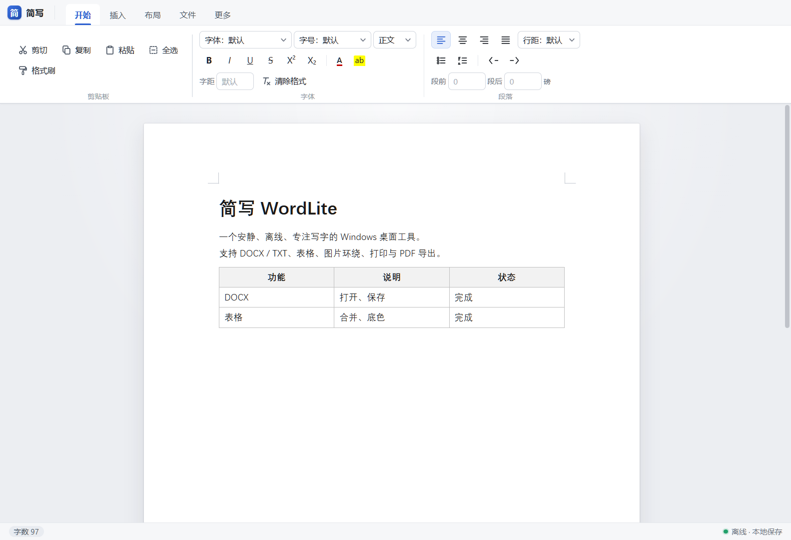

<p align="center">
  
</p>

<h1 align="center">简写 WordLite</h1>

<p align="center">
  <b>离线、轻量、像 Word 一样顺手的桌面写字板</b><br>
  打开就写，写完就存。不联网、不登录、不收集任何数据。
</p>

<p align="center">
  
  
  
  
</p>

<p align="center">
  <b>简体中文</b> · <a href="README.en.md">English</a>
</p>

<p align="center">
  
</p>

## 为什么做它

写一份通知、一篇稿子、一张带表格的清单，往往不需要一整套 Office，也不想把文件传到云端。
简写只做一件事：**在本机把文字排好、存成 DOCX，或者直接打印 / 导出 PDF**。

- 🔒 **完全离线**：应用内拦截所有网络请求，文件只经过系统对话框读写
- 📄 **认 DOCX**：能打开 Word / WPS 文档，保存后也能被它们正常打开
- 🪶 **上手零成本**：熟悉的「开始 / 插入 / 布局 / 文件」功能区，常用快捷键和 Word 一致
- 💾 **不怕丢稿**：定时自动保存，意外关闭后重新打开可恢复

## 下载使用

1. 到 [Releases](../../releases/latest) 下载 `WordLite-<版本>-portable.zip`
2. 解压到任意文件夹（**整个文件夹都要保留**，不能只拷 exe）
3. 双击 `WordLite.exe`

> 免安装、不写注册表，删掉文件夹即卸载。
> 程序暂未做代码签名，首次运行若出现「Windows 已保护你的电脑」，点 **更多信息 → 仍要运行**。

## 功能一览

| 类别 | 能做什么 |
| --- | --- |
| 文件 | 打开 / 保存 DOCX、TXT（自动识别 UTF-8、UTF-16、GBK），最近文件，自动保存与崩溃恢复 |
| 文字 | 字体、字号、颜色、高亮、加粗、斜体、下划线、删除线、上标、下标、字符间距、格式刷 |
| 段落 | 标题 1–3、对齐、缩进、行距、段前段后间距、项目符号、编号列表 |
| 表格 | 插入、拖动列宽、合并 / 拆分单元格、单元格底色、边框粗细与颜色 |
| 图片 | 插入、精确缩放、左 / 中 / 右对齐、文字环绕、裁剪、更换、删除 |
| 页面 | 纸张大小、横竖方向、自定义页边距、页面背景色、分页符 |
| 输出 | 打印预览、指定页码范围与份数、导出 PDF |

<details>
<summary><b>快捷键</b>（应用内按 <kbd>F1</kbd> 也能看）</summary>

| 操作 | 快捷键 |
| --- | --- |
| 新建 / 打开 / 保存 / 另存为 | <kbd>Ctrl+N</kbd> / <kbd>Ctrl+O</kbd> / <kbd>Ctrl+S</kbd> / <kbd>Ctrl+Shift+S</kbd> |
| 打印预览 | <kbd>Ctrl+P</kbd> |
| 加粗 / 斜体 / 下划线 | <kbd>Ctrl+B</kbd> / <kbd>Ctrl+I</kbd> / <kbd>Ctrl+U</kbd> |
| 删除线 | <kbd>Ctrl+Shift+X</kbd> |
| 上标 / 下标 | <kbd>Ctrl+Shift+=</kbd> / <kbd>Ctrl+=</kbd> |
| 增大 / 减小字号 | <kbd>Ctrl+Shift+&gt;</kbd> / <kbd>Ctrl+Shift+&lt;</kbd> |
| 格式刷：复制 / 应用 | <kbd>Ctrl+Shift+C</kbd> / <kbd>Ctrl+Shift+V</kbd> |
| 标题 1 / 2 / 3 / 正文 | <kbd>Ctrl+1</kbd> / <kbd>Ctrl+2</kbd> / <kbd>Ctrl+3</kbd> / <kbd>Ctrl+0</kbd> |
| 左 / 中 / 右 / 两端对齐 | <kbd>Ctrl+L</kbd> / <kbd>Ctrl+E</kbd> / <kbd>Ctrl+R</kbd> / <kbd>Ctrl+J</kbd> |
| 项目符号 / 编号 | <kbd>Ctrl+Shift+8</kbd> / <kbd>Ctrl+Shift+7</kbd> |
| 增加 / 减少缩进 | <kbd>Ctrl+M</kbd> / <kbd>Ctrl+Shift+M</kbd> |
| 插入分页符 | <kbd>Ctrl+Enter</kbd> |

</details>

## 从源码运行

需要 [Node.js](https://nodejs.org/) 22 或更高版本。

```bash
git clone <本仓库地址>
cd wordlite
npm install
npm start          # 构建并启动
```

其他命令：

```bash
npm run build      # 只构建渲染进程 renderer/bundle.js
npm run smoke      # 构建 + 启动冒烟测试（自动退出）
node tools/package-portable.cjs   # 打包 Windows 便携版到 dist/
```

Windows 用户也可以直接双击根目录的 `启动简写.bat`（开发运行）和 `打包便携版.bat`（打包）。

<details>
<summary><b>项目结构</b></summary>

```text
main.js                 主进程：窗口、文件读写、打印 / PDF
preload.js              通过 contextBridge 暴露的最小 API
renderer/
  index.html            界面结构
  style.css             界面与打印样式
  app.js                编辑器、功能区、文件、打印、设置
  docx.js               DOCX 导入 / 导出
  extensions.js         TipTap 自定义扩展（表格、图片、段落格式等）
tools/
  package-portable.cjs  便携版打包脚本
  make-icon.py          图标生成脚本（Python + Pillow）
assets/                 应用图标
docs/                   README 截图
```

`renderer/bundle.js` 是构建产物，不进仓库。

</details>

## 隐私与安全

- 渲染进程开启 `contextIsolation` + `sandbox`，关闭 `nodeIntegration`
- 只通过 preload 暴露有限的文件 / 打印接口
- 拦截全部 `http` / `https` / `ws` / `wss` 请求，应用本身不会联网
- 除剪贴板读取外，拒绝所有浏览器权限请求
- 无统计、无遥测、无自动更新

## 已知限制

- 目前只打包和测试了 Windows；macOS / Linux 可从源码运行，但未经验证
- 打印 / PDF 按分页符分页，长段落自动换页的位置可能和屏幕显示略有差异
- 文本框、嵌套表格、复杂域等 DOCX 对象导入时会被简化
- 图片文字环绕支持左右两种
- 发布包暂无代码签名和安装程序

## 常见问题

**双击 exe 没反应？**
确认解压的是完整文件夹（含 `resources`、各种 `.dll`），不要只拷贝 `WordLite.exe`。

**从源码 `npm start` 不出窗口？**
如果系统里设置了环境变量 `ELECTRON_RUN_AS_NODE`，Electron 会以纯 Node 模式运行。删除该变量，或改用 `启动简写.bat`（会自动清掉它）。

**文件存在哪？**
你保存到哪里就在哪里。自动保存的恢复副本在 `%APPDATA%\简写\autosave.json`，正常保存或选择「不保存」关闭后会清理。

## 参与贡献

欢迎提 Issue 和 Pull Request。提交前请至少跑一遍：

```bash
npm run smoke
```

修 Bug 时附上能复现问题的文档样本（去掉隐私内容），会大大加快处理速度。

## 致谢

- [Electron](https://www.electronjs.org/) — 桌面外壳
- [TipTap](https://tiptap.dev/) / [ProseMirror](https://prosemirror.net/) — 编辑器内核
- [docx](https://github.com/dolanmiu/docx) — DOCX 导出
- [mammoth](https://github.com/mwilliamson/mammoth.js) — DOCX 导入
- [JSZip](https://stuk.github.io/jszip/) — DOCX 打包解包

### AI 辅助

- [DeepSeek](https://www.deepseek.com/) — 开发辅助
- [Kimi](https://kimi.moonshot.cn/) — 开发辅助

## 许可证

[MIT](LICENSE)
