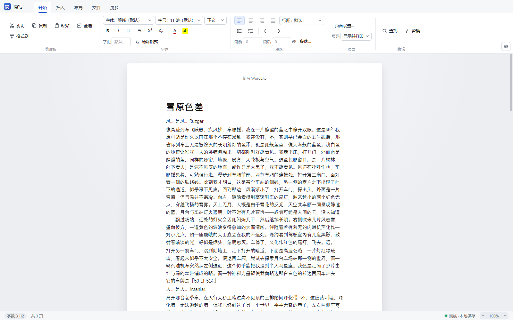
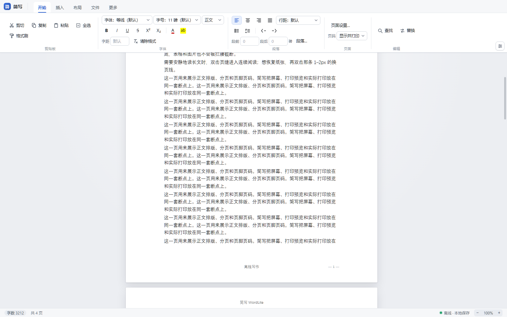

<p align="center">
  
</p>

<h1 align="center">简写 WordLite</h1>

<p align="center">
  <b>离线、轻量、像 Word 一样顺手的桌面写字板</b><br>
  打开就写，写完就存。不联网、不登录、不收集任何数据。
</p>

<p align="center">
  
  
  
  
</p>

<p align="center">
  <b>简体中文</b> · <a href="README.en.md">English</a>
</p>

<p align="center">
  
</p>

<p align="center">
  
  <br>
  <sub>屏幕分页、页眉页脚与页码；打印预览和 PDF 使用同一套断点。</sub>
</p>

## 为什么做它

写一份通知、一篇稿子、一张带表格的清单，往往不需要一整套 Office或AI工具，也不想把文件传到云端。
简写只做一件事：**在本机把文字排好、存成 DOCX，或者直接打印 / 导出 PDF**。

- 🔒 **完全离线**：应用不发起网络请求，文件只经过系统对话框读写
- 📄 **认 DOCX**：能打开 Word / WPS 文档，保存后也能被它们正常打开
- 🪶 **足够轻**：Tauri 2 + 系统 WebView（Windows 是 WebView2，macOS 是 WKWebView），安装包只有几 MB，启动快、内存占用低
- 🪟 **多窗口**：拖入文件或右键「打开方式」会新开独立窗口，方便并排对比；应用内打开留在当前窗口
- 💾 **不怕丢稿**：定时自动保存，意外关闭后重新打开可恢复

## 下载使用

### Windows 10 / 11

1. 到 [Releases](../../releases/latest) 下载 `WordLite_<版本>_x64-setup.exe`
2. 双击安装
3. 从开始菜单或桌面启动

> 程序暂未做代码签名，首次运行若出现「Windows 已保护你的电脑」，点 **更多信息 → 仍要运行**。
> 需要 Microsoft Edge WebView2 运行时；Windows 11 和大部分 Windows 10 已自带。

### macOS 13 Ventura 或更新版本

1. 到 [Releases](../../releases/latest) 下载 `WordLite_<版本>_universal.dmg`。同一个包同时支持 Apple 芯片和 Intel
2. 双击打开 dmg，把里面的应用图标拖进「应用程序」（中文系统里显示为「简写」，英文系统里显示为 WordLite）
3. 首次打开：程序是 ad-hoc 签名，没有 Apple 公证，直接双击会提示「无法打开，因为 Apple 无法检查其是否包含恶意软件」。打开 **系统设置 → 隐私与安全性**，在下方提示里点 **仍要打开**，再确认一次；随后系统会要求输入开机密码，输入后再点一次 **仍要打开**
4. 装好后菜单栏和程序坞里显示的名字是「简写」

> macOS 13 / 14 还可以按住 <kbd>Control</kbd> 点图标选「打开」；macOS 15 之后这条捷径被系统取消了，只能走「系统设置 → 隐私与安全性」。
> 需要 macOS 13 Ventura 或更新版本（系统 WKWebView 版本为 Safari 16 以上）。
> v1.2.0 的 macOS 包已通过 CI 构建；当前 Release 先提供 Windows 安装包，Mac dmg 随后补到同一个 Release。
> 在 Mac 上自行构建见下面「从源码运行」。

## 功能一览

| 类别 | 能做什么 |
| --- | --- |
| 文件 | 打开 / 保存 DOCX、TXT（自动识别 UTF-8、UTF-16、GBK），双击 / 右键「打开方式」/ 拖入窗口打开，最近文件，自动保存与崩溃恢复 |
| 编辑 | 查找 / 替换，区分大小写，高亮全部匹配并逐个跳转；选中文字可拖到别处（Ctrl+拖为复制），图片可在文档流里拖动 |
| 窗口 | 应用内打开留在当前窗口（未保存时提示保存 / 不保存 / 取消）；拖入或右键打开时新开独立窗口；10%–1000% 页面缩放（Ctrl+滚轮 / 触控板捏合 / 状态栏） |
| 文字 | 字体、字号（下拉框显示实际默认值）、颜色、高亮、加粗、斜体、下划线、删除线、上标、下标、字符间距、格式刷 |
| 段落 | 标题 1–3、对齐、缩进、行距（倍数 / 固定值磅）、段前段后（磅）、项目符号、编号列表、段落设置对话框 |
| 表格 | 插入、拖动列宽、合并 / 拆分单元格、单元格底色、边框粗细与颜色 |
| 图片 | 插入、拖动移动、精确缩放、左 / 中 / 右对齐、环绕（四周型 / 上下型）、可视化裁剪、右侧面板实时预览与一步撤销、查看大图、更换、删除 |
| 页面 | A4 屏幕分页（按行拆页、标题与下段同页、表格 / 图片整块不拆）、连续阅读（双击页缝）、纸张大小、横竖方向、自定义页边距、纸色、页码三档（不显示 / 仅屏幕 / 显示并打印）、页眉页脚、按行 / 整段分页、页面设置、手动分页符 |
| 界面 | 工具栏不换行；右下角详细工具侧板（宽窗停靠、窄窗浮动）；字体 / 字号默认标签；页数与连续阅读状态提示 |
| 输出 | 打印（Ctrl+P 直接打开系统打印页，页码范围、份数、预览都在那里调）、导出 PDF；屏幕 / 打印预览 / PDF 使用同一套分页断点，打印时拦截误关窗口 |

<details>
<summary><b>快捷键</b>（应用内按 <kbd>F1</kbd> 也能看，Mac 上是 <kbd>⌘?</kbd>）</summary>

| 操作 | Windows | Mac |
| --- | --- | --- |
| 新建 / 打开 / 保存 / 另存为 | <kbd>Ctrl+N</kbd> / <kbd>Ctrl+O</kbd> / <kbd>Ctrl+S</kbd> / <kbd>Ctrl+Shift+S</kbd> | <kbd>⌘N</kbd> / <kbd>⌘O</kbd> / <kbd>⌘S</kbd> / <kbd>⇧⌘S</kbd> |
| 打印 | <kbd>Ctrl+P</kbd> | <kbd>⌘P</kbd> |
| 查找 / 替换 | <kbd>Ctrl+F</kbd> / <kbd>Ctrl+H</kbd> | <kbd>⌘F</kbd> / <kbd>⌥⌘F</kbd> |
| 右键菜单 | <kbd>Shift+F10</kbd> 或菜单键 | <kbd>⇧F10</kbd> |
| 加粗 / 斜体 / 下划线 | <kbd>Ctrl+B</kbd> / <kbd>Ctrl+I</kbd> / <kbd>Ctrl+U</kbd> | <kbd>⌘B</kbd> / <kbd>⌘I</kbd> / <kbd>⌘U</kbd> |
| 删除线 | <kbd>Ctrl+Shift+X</kbd> | <kbd>⇧⌘X</kbd> |
| 上标 / 下标（上标用工具栏） | — / <kbd>Ctrl+=</kbd> | — / <kbd>⌘=</kbd> |
| 页面放大 / 缩小 | <kbd>Ctrl+Shift+=</kbd> / <kbd>Ctrl+Shift+-</kbd> | <kbd>⇧⌘=</kbd> / <kbd>⇧⌘-</kbd> |
| 增大 / 减小字号 | <kbd>Ctrl+Shift+&gt;</kbd> / <kbd>Ctrl+Shift+&lt;</kbd> | <kbd>⇧⌘&gt;</kbd> / <kbd>⇧⌘&lt;</kbd> |
| 格式刷：复制 / 应用 | <kbd>Ctrl+Shift+C</kbd> / <kbd>Ctrl+Shift+V</kbd> | <kbd>⇧⌘C</kbd> / <kbd>⇧⌘V</kbd> |
| 标题 1 / 2 / 3 / 正文 | <kbd>Ctrl+1</kbd> / <kbd>Ctrl+2</kbd> / <kbd>Ctrl+3</kbd> / <kbd>Ctrl+0</kbd> | <kbd>⌘1</kbd> / <kbd>⌘2</kbd> / <kbd>⌘3</kbd> / <kbd>⌘0</kbd> |
| 左 / 中 / 右 / 两端对齐 | <kbd>Ctrl+L</kbd> / <kbd>Ctrl+E</kbd> / <kbd>Ctrl+R</kbd> / <kbd>Ctrl+J</kbd> | <kbd>⌘L</kbd> / <kbd>⌘E</kbd> / <kbd>⌘R</kbd> / <kbd>⌘J</kbd> |
| 项目符号 / 编号 | <kbd>Ctrl+Shift+8</kbd> / <kbd>Ctrl+Shift+7</kbd> | <kbd>⇧⌘8</kbd> / <kbd>⇧⌘7</kbd> |
| 增加 / 减少缩进 | <kbd>Ctrl+M</kbd> / <kbd>Ctrl+Shift+M</kbd> | <kbd>⌘]</kbd> / <kbd>⌘[</kbd> |
| 插入分页符 | <kbd>Ctrl+Enter</kbd> | <kbd>⌘Enter</kbd> |
| 图片编辑：完成 / 取消 / 进裁剪 | <kbd>Enter</kbd>（或 <kbd>Ctrl+Enter</kbd>） / <kbd>Esc</kbd> / <kbd>C</kbd> | <kbd>Enter</kbd>（或 <kbd>⌘Enter</kbd>） / <kbd>Esc</kbd> / <kbd>C</kbd> |
| 选中图片后查看大图 | <kbd>空格</kbd> | <kbd>空格</kbd> |

Mac 上 <kbd>Ctrl</kbd> 组合键不拦截：<kbd>Ctrl+A</kbd> / <kbd>Ctrl+E</kbd> / <kbd>Ctrl+K</kbd> 等仍是系统的行首 / 行尾 / 删到行尾。替换用 <kbd>⌥⌘F</kbd>、缩进用 <kbd>⌘]</kbd> / <kbd>⌘[</kbd>，是因为 <kbd>⌘H</kbd>（隐藏）和 <kbd>⌘M</kbd>（最小化）被系统占用。

</details>

## 从源码运行

通用要求：

- [Node.js](https://nodejs.org/) 22 或更高版本
- [Rust](https://rustup.rs/) stable 工具链

Windows 还需要：

- Visual Studio Build Tools（C++ 工作负载）和 Windows SDK
- Microsoft Edge WebView2 运行时

macOS 还需要：

- Xcode Command Line Tools：`xcode-select --install`
- 最低系统版本 macOS 13.0 Ventura（对应 Safari 16 的内核）；打 Universal 包还要 `rustup target add aarch64-apple-darwin x86_64-apple-darwin`

```bash
git clone <本仓库地址>
cd WordLite
npm install
npm run tauri:dev     # 构建前端并启动 Tauri 窗口
```

构建安装包：

```bash
npm run tauri:build   # Windows 产物在 src-tauri/target/release/bundle/nsis/
                      # macOS 产物在 src-tauri/target/release/bundle/dmg/
npm run build         # 只重建 renderer/bundle.js
```

在 Mac 上打 Universal 包（Apple 芯片 + Intel 共用一个 dmg）：

```bash
rustup target add aarch64-apple-darwin x86_64-apple-darwin
npx tauri build --target universal-apple-darwin --bundles app,dmg
# 产物：src-tauri/target/universal-apple-darwin/release/bundle/dmg/WordLite_<版本>_universal.dmg
```

自测：

```bash
# Windows
src-tauri/target/release/wordlite.exe --selftest

# macOS
"src-tauri/target/release/bundle/macos/WordLite.app/Contents/MacOS/wordlite" --selftest
```

> 首次打包会从 GitHub 下载 NSIS 工具（仅 Windows）；macOS 的 dmg 用系统自带的工具生成。
> 推送 `v*` 标签会触发 GitHub Actions 同时构建 Windows 和 macOS 安装包，并建一个草稿 Release（见 `.github/workflows/build.yml`）。

<details>
<summary><b>项目结构</b></summary>

```text
src-tauri/              Tauri 2 / Rust 主进程
  src/lib.rs            窗口、文件、自动保存、打印 / PDF
  tauri.conf.json       窗口、CSP、打包配置
  capabilities/         权限（main 与 doc-* 窗口）
renderer/
  index.html            界面结构
  style.css             界面与打印样式
  app.js                编辑器、功能区、文件、打印、设置
  docx.js               DOCX 导入 / 导出
  extensions.js         TipTap 自定义扩展（表格、图片、段落格式等）
  tauri-bridge.js       Tauri 下的 window.wordlite 兼容层
tools/
  make-icon.py          图标生成脚本（Python + Pillow）
assets/                 应用图标
docs/                   README 截图与迁移笔记
```

`renderer/bundle.js` 是构建产物，不进仓库。

</details>

## 隐私与安全

- Tauri 2 + Rust 后端，前端只能调用白名单内的命令
- 文件通过系统原生对话框读写，不经过浏览器上传
- CSP 限制为 `default-src 'self'`，应用本身不发起网络请求
- 无统计、无遥测、无自动更新

## 已知限制

- 已打包和测试 Windows 10 / 11、macOS 13 Ventura 及以上（v1.2.0 的 Universal 包已在 macOS CI 跑过三组自测；Intel 真机没有复测，更老的 macOS 没有测试）
- 从 Dock 图标右键「退出」、注销或关机时，程序不会弹保存提示，会直接退出；未保存的内容靠自动保存恢复，重新打开时会提示恢复
- 发布包没有 Apple 公证（macOS 用 ad-hoc 签名），首次打开要按「下载使用」里的步骤放行；Windows 安装包也没有代码签名
- Mac 上的分页、连续阅读、段落和 PDF 页数已通过 CI 自测；物理 Mac 上的打印面板、@page 页眉页脚 / 页码的实际位置还没有人工目视核对
- 文本框、嵌套表格、复杂域等 DOCX 对象导入时会被简化
- DOCX 导入只恢复写在文字（run）上的直接格式：`w:color` 文字颜色、`w:highlight` 荧光笔高亮、run 级 `w:shd` 字符底纹。主题色取 `w:color/@w:val` 里 Word 存下的缓存色值（没有缓存值的主题色不恢复）；颜色/底纹写在字符样式或段落样式里的、以及段落底纹，导入后不恢复。对齐不上时宁可不染色，不会把颜色染到别的字上
- 图片文字环绕支持嵌入型、四周型（左 / 右）和上下型；紧密型、穿越型、衬于文字下 / 浮于文字上的环绕导入时会被简化并给出提示
- 拖动文字和图片、裁剪时的调框只支持鼠标；触摸屏长按拖动、裁剪里的滚轮缩放和框内平移还没有做（触控笔未实测）
- 图片查看器只用来查看：不能切换上一张 / 下一张、不能另存为图片，也不支持双指缩放（触控板捏合会走 Ctrl+滚轮）

## 常见问题

**双击安装包没反应或提示「已保护你的电脑」？**
程序暂未签名，点「更多信息 → 仍要运行」。安装完成后从开始菜单启动。

**macOS 提示「无法打开，因为 Apple 无法检查其是否包含恶意软件」？**
程序没有做 Apple 公证，不是文件坏了。打开「系统设置 → 隐私与安全性」，在下方提示里点「仍要打开」，再确认一次。系统会要求输入开机密码，输入后再点一次「仍要打开」。之后就能正常双击启动。

**提示缺少 WebView2？**
安装 Microsoft Edge [WebView2](https://developer.microsoft.com/zh-cn/microsoft-edge/webview2) Runtime（Windows 11 和大部分 Windows 10 已自带）。这一条只影响 Windows，macOS 用的是系统自带的 WKWebView。

**文件存在哪？**
你保存到哪里就在哪里。自动保存的恢复副本：Windows 在 `%APPDATA%\com.h1kayemizbitti.wordlite\autosave-*.json`，macOS 在 `~/Library/Application Support/com.h1kayemizbitti.wordlite/autosave-*.json`；正常保存或选择「不保存」关闭后会清理。

## 参与贡献

欢迎提 Issue 和 Pull Request。提交前请至少跑一遍构建和自测：

```bash
npm run tauri:build
# Windows
src-tauri/target/release/wordlite.exe --selftest
# macOS
"src-tauri/target/release/bundle/macos/WordLite.app/Contents/MacOS/wordlite" --selftest
```

修 Bug 时附上能复现问题的文档样本（去掉隐私内容），会大大加快处理速度。

## 致谢

- [Tauri](https://tauri.app/) / [WebView2](https://learn.microsoft.com/microsoft-edge/webview2/) / [WKWebView](https://developer.apple.com/documentation/webkit/wkwebview) — 桌面外壳
- [TipTap](https://tiptap.dev/) / [ProseMirror](https://prosemirror.net/) — 编辑器内核
- [docx](https://github.com/dolanmiu/docx) — DOCX 导出
- [mammoth](https://github.com/mwilliamson/mammoth.js) — DOCX 导入
- [JSZip](https://stuk.github.io/jszip/) — DOCX 打包解包

### AI 辅助

- [DeepSeek](https://www.deepseek.com/) — 开发辅助
- [Kimi](https://kimi.moonshot.cn/) — 开发辅助
- [Claude](https://claude.ai) — 开发辅助

## 贡献者 ✨

感谢这些为 WordLite 做出贡献的人（[emoji 含义](https://allcontributors.org/en/reference/emoji-key/)）：

<!-- ALL-CONTRIBUTORS-LIST:START - Do not remove or modify this section -->
<!-- prettier-ignore-start -->
<!-- markdownlint-disable -->
<table>
  <tbody>
    <tr>
      <td align="center" valign="top" width="14.28%"><a href="https://github.com/custodiet0512"><br /><sub><b>Wyatt</b></sub></a><br /><a href="https://github.com/H1kayemizBitti/WordLite/commits?author=custodiet0512" title="Tests">⚠️</a></td>
    </tr>
  </tbody>
  <tfoot>
    <tr>
      <td align="center" size="13px" colspan="7">
        
          <a href="https://all-contributors.js.org/docs/en/bot/usage">Add your contributions</a>
        </img>
      </td>
    </tr>
  </tfoot>
</table>

<!-- markdownlint-restore -->
<!-- prettier-ignore-end -->

<!-- ALL-CONTRIBUTORS-LIST:END -->

本项目遵循 [all-contributors](https://github.com/all-contributors/all-contributors) 规范，欢迎任何形式的贡献！

## 许可证

[MIT](LICENSE)
